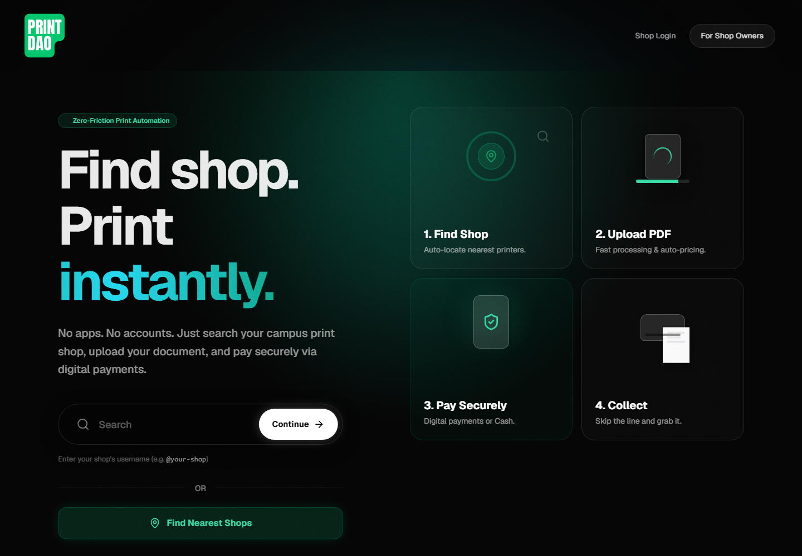

# Printdao — Product & Engineering Case Study

Guest-first print ordering for university-area print shops in Bangladesh.

[Live website](https://printdao.vercel.app/) · Portfolio by [Tanjil Hasan Himel](https://github.com/TanjilHasan-Himel)

Printdao connects a student's browser, a shop owner's dashboard and a Windows print bridge. Its product goal is simple: submit and track a print order without creating a student account, while preserving the shop owner's control over payment verification and printing.

## Explore the work

| Perspective | Read |
| --- | --- |
| Product problem, scope and learning | [Case study](case-study.md) |
| Business analysis, BRD, risks and traceability | [Business analysis](01-business-analysis/README.md) |
| Requirements and acceptance criteria | [Product requirements](product-requirements.md) |
| System boundaries and workflow | [Architecture](architecture.md) |
| Trade-offs and reconstructed rationale | [Engineering decisions](engineering-decisions.md) |
| Repository milestones | [Development timeline](development-timeline.md) |
| Evidence and open gaps | [Testing and limitations](testing-and-limitations.md) |
| Genuine interface captures | [Screenshots](screenshots/README.md) |

## Evidence standard

Prepared on 2026-11-06. **VERIFIED** means directly observed, with its scope stated; source inspection does not establish runtime correctness. **DOCUMENTED** means stated in project requirements or notes. **INFERRED** means reconstructed interpretation. **PROPOSED** means future work. **UNKNOWN / UNVERIFIED** means evidence is missing.

This is an AI-assisted repository analysis and writing package. It does not assert that the application was independently hand-coded, or establish an individual contribution breakdown. No measured adoption, revenue, performance or customer outcomes are claimed. Application source and private evidence are excluded from this portfolio.
