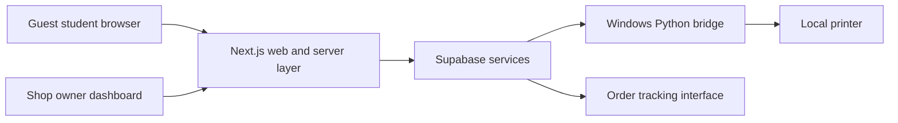
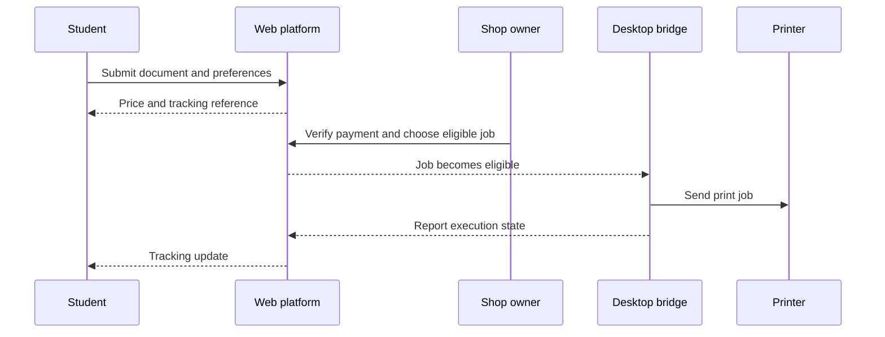

# Architecture overview

**VERIFIED — repository inventory:** Next.js 14 / React / TypeScript web application, Supabase integration and migrations, and a Python Windows bridge are present. **DOCUMENTED:** Vercel hosting and Supabase database, authentication, storage and realtime services. Production configuration was not audited.

## Responsibilities and boundaries

The browser collects documents and print preferences. Server-side operations validate orders and calculate totals. The backend stores shop/order data and documents. The owner controls operational approval. The desktop bridge retrieves jobs, selects configured printers and reports progress.

This is a high-level conceptual diagram; it intentionally omits internal endpoints, credentials, storage identifiers and database schemas. Notification paths are documented design, not a claim of verified delivery guarantees.

## Intended business sequence

**UNVERIFIED:** End-to-end delivery, multi-device concurrency, crash recovery and physical output. A software completion state alone is not proof that paper emerged from the printer.
