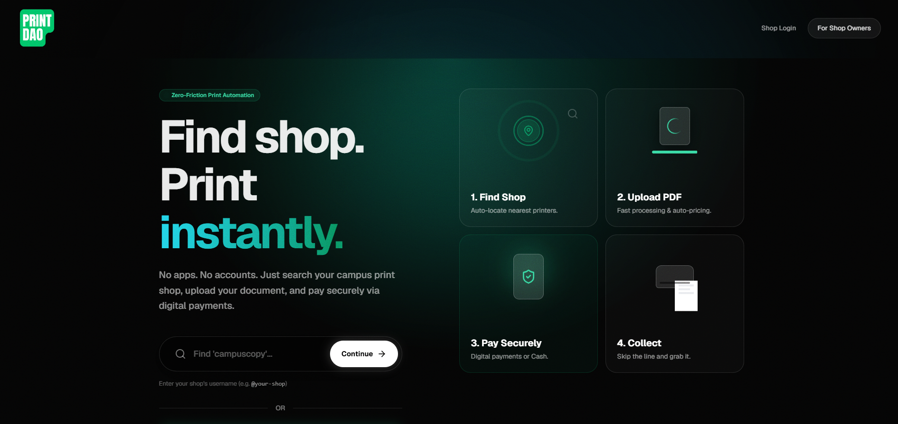
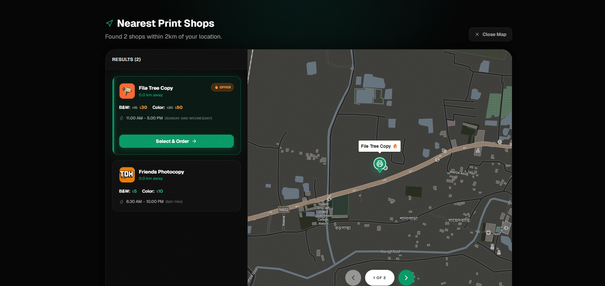
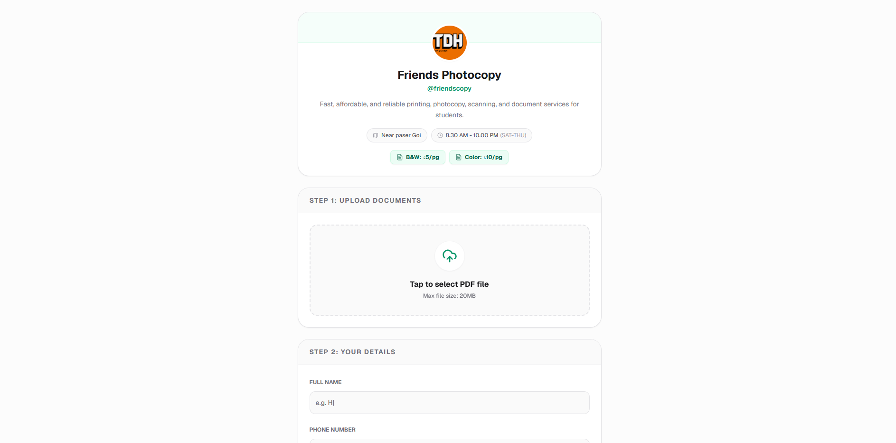
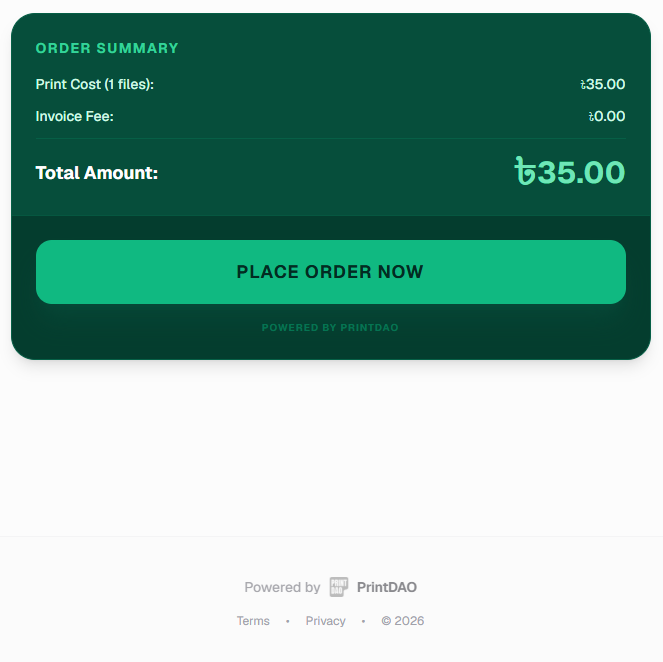
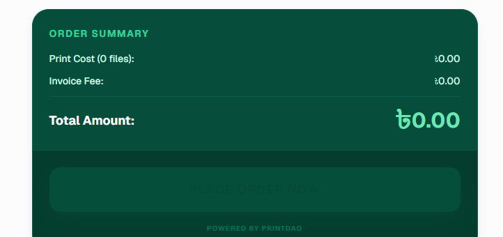
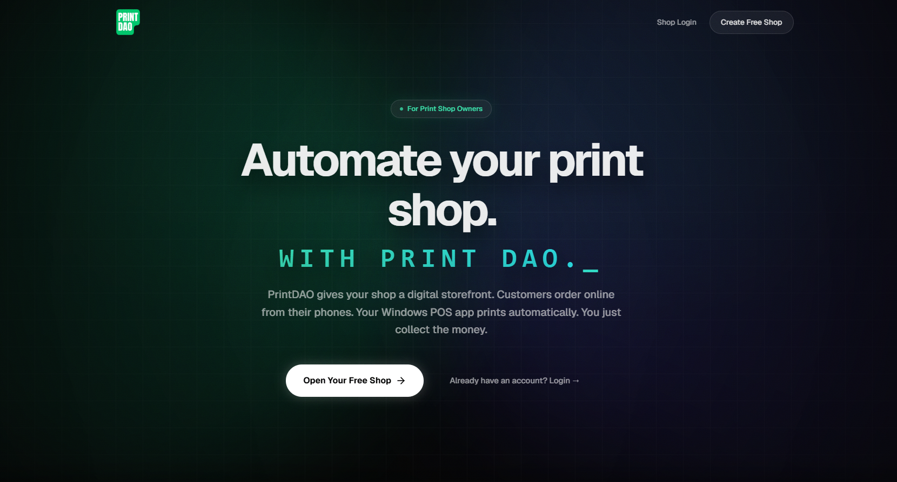
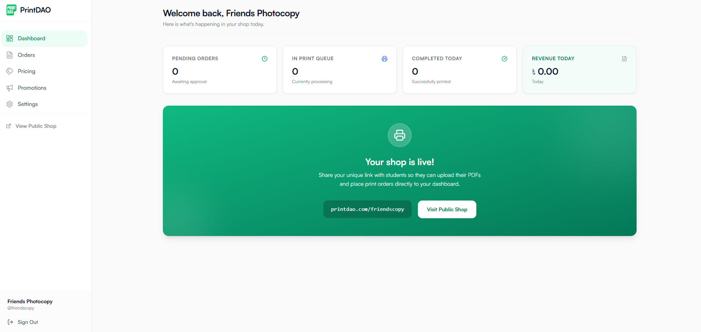

# Project screenshot gallery

## Developer-supplied captures

Supplied by Tanjil Hasan Himel for this case study on 2026-11-06. Original capture dates and environments are unknown. Images below are unaltered, visually reviewed interface evidence, not independent tests of ordering, payment or physical printing. Displayed prices and dashboard values are historical UI contents, not current quotes or impact metrics.

### Customer landing

Shop search and the intended upload-to-collection journey.

### Nearby shop discovery

A map and shop cards with displayed pricing and opening hours. Map locations and distances are supplied screenshot content, not a verified location test.

### Shop profile and PDF upload

Friends Photocopy profile, upload control and customer-details form. The screen shows the entry point; no upload was executed during this review.

### Populated order summary

A one-file summary with a displayed total and order button. This capture does not establish payment or successful submission. A near-identical second capture was omitted.

### Empty order summary

A zero-file summary and a visibly inactive order button, included as a distinct interface state.

### Shop-owner landing

Owner onboarding and the product's automation proposition. Marketing text inside the image is not independent verification of printer behavior.

### Shop-owner dashboard

Navigation, queue/revenue cards and the public-shop link. Zero values are interface contents, not measured business results. The domain printed inside the supplied screenshot is historical UI content; use the case study's Vercel link to explore the app.

## Review-session browser evidence

These two captures were taken directly from the public deployment on 2026-11-06 with a fresh headless Chrome profile, without signing in or submitting forms. They are retained as linked evidence rather than repeated in the gallery.

| Capture | Scope |
| --- | --- |
| [Review-session landing](landing-desktop.png) | 1440 ? 1000 browser window, first viewport |
| [Narrow login](login-mobile.png) | Requested 390 ? 844 desktop-browser window, not mobile-device emulation; right-side content visibly clips |

## Privacy and evidence limits

The supplied payment-details image and order-confirmation image were excluded because they expose a payment account number and a tracking code. Originals were not altered. The desktop software is not shown in these captures. No end-to-end or physical-print test is implied by this gallery.
